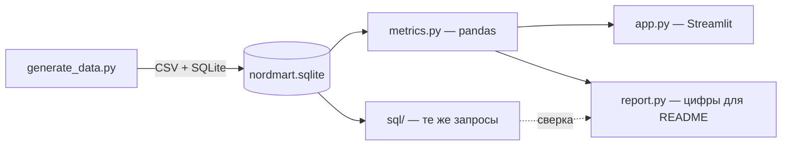

# NordMart — воронка и удержание

<p align="center">
  
  
  
  
  
</p>

<p align="center">
  <b>Product analytics case · e-commerce</b><br/>
  Где ломается оплата, какой трафик пустой, кого магазин удерживает<br/>
  <i>Разбор воронки интернет-магазина по шагам, устройствам, каналам и категориям — не средний CR, а точка провала.</i>
</p>

<p align="center">
  <b>Решение.</b> Главный рычаг — mobile checkout, не верх воронки. Mobile платит из чекаута на <b>36% реже desktop</b>
  (iOS и Android одинаково). Закрыть половину разрыва ≈ <b>+0.5 млн ₽ в месяц</b>.
</p>

---

## О проекте

**NordMart** — учебный кейс портфолио для стажировки **product analyst**: 8 недель сессий условного интернет-магазина.

Продуктовый вопрос: трафик растёт, а выручка отстаёт — на каком шаге воронки и в каком сегменте (девайс, канал, категория) теряем оплату, сколько это стоит и что чинить первым.

> **Данные синтетические.** Эффекты (просадка mobile checkout, слабый paid social, брошенные корзины в электронике) заложены в `generate_data.py`. Цель кейса — показать, как такие эффекты находят, проверяют статистикой и переводят в деньги. Все цифры ниже печатает `python src/report.py`; он же сверяет pandas с SQL.

```text
┌────────────────────────────────────────────────────────────┐
│                === NORDMART DASHBOARD ===                  │
│                                                            │
│  KPI: users · sessions · CR · AOV · repeat                 │
│  Воронка: сессия → просмотр → корзина → чекаут → оплата    │
│  Checkout → pay по device + CI   Канал: CR × revenue/session│
│  Эффект починки mobile в ₽       Когорты: retention        │
│  Категории: где бросают                                    │
└────────────────────────────────────────────────────────────┘
```

---

## Стек

| Технология     | Зачем в проекте                                              |
| -------------- | ------------------------------------------------------------- |
| **Python 3.10+** | язык генератора данных и аналитики                           |
| **pandas**       | расчёт воронки, когорт, KPI и оценки эффекта                  |
| **SQLite + SQL** | те же метрики через запросы — `report.py` проверяет, что pandas и SQL совпадают |
| **Streamlit**    | дашборд: KPI-карточки, графики, текстовые выводы              |
| **Plotly**       | воронка, бары с CI по девайсам, scatter по каналам, кривая и heatmap когорт |

---

## Что нашёл

|     | Находка                    | Что значит                                                              |
| --- | --------------------------- | ------------------------------------------------------------------------ |
| ✓   | **Mobile checkout**          | Checkout → pay: desktop **76.1%**, mobile **48.6%** — Δ −27.4 п.п. [−30.3 … −24.6], p < 0.001 |
| ✓   | **Дело не в iOS**            | iOS 49.0% vs Android 48.2%, p = 0.71 — проблема в мобильном чекауте целиком |
| ✓   | **Цена проблемы**            | Закрыть 50% разрыва: +341 заказ за 55 дней, **≈ +494 тыс. ₽ / 30 дней** (+13% выручки). Потолок ≈ +988 тыс. ₽ |
| ✓   | **Paid social — объём без качества** | Корзина в 14.6% сессий против 24–33% у других каналов, выручка на сессию 120 ₽ против 205–383 ₽ |
| ✓   | **Email — лучший канал**     | Меньше сессий, но CR 13.0% и **383 ₽** на сессию                         |
| ✓   | **Electronics бросают корзину** | Кладут в корзину чаще всех (32%), но до чекаута доходят 46% против ~60% у остальных |
| ✓   | **Retention**                | 2-я неделя жизни — 33%, 3-я — 21%, 4-я — 14%: плавное затухание, когорты стабильны |

### Модель данных

```text
users     user_id, first_seen, acq_channel, primary_device
sessions  session_id, user_id, session_ts, device, channel, category
events    event_id, session_id, user_id, event_ts, event_name, category, revenue

FUNNEL_STEPS = session_start → view_item → add_to_cart → begin_checkout → purchase
```

---

## Архитектура



| Файл                  | Ответственность                                                   |
| ---------------------- | -------------------------------------------------------------------- |
| `src/generate_data.py` | синтетика: 12 000 пользователей, возвраты с оттоком, вероятности шагов по каналу/девайсу/категории |
| `src/metrics.py`       | воронка, когорты с обрезкой, CI и тесты долей, оценка эффекта — единственный аналитический слой |
| `src/report.py`        | печатает все цифры README и сверяет pandas с SQL                    |
| `sql/`                 | те же вопросы на чистом SQL: воронка, когорты, каналы               |
| `app.py`               | дашборд: графики + текстовые продуктовые выводы                    |

**Почему так?** Дашборд не считает метрики сам — только вызывает функции `metrics.py`, чтобы логика жила в одном месте. SQL дублирует pandas: воронка считается через флаги событий в сессии (`MAX(event_name = 'purchase')`), а `report.py` проверяет, что оба слоя дают одинаковые числа.

---

## Структура

```text
nordmart-funnel-analytics
├── app.py
├── README.md
├── requirements.txt
├── src
│   ├── generate_data.py
│   ├── metrics.py
│   └── report.py
├── sql
│   ├── 01_funnel.sql
│   ├── 02_cohorts.sql
│   └── 03_channels.sql
└── data              ← создаётся генератором, в git не хранится
    ├── users.csv
    ├── sessions.csv
    ├── events.csv
    └── nordmart.sqlite
```

---

## Быстрый старт

### 1. Требования

- Python **3.10+**

### 2. Установка

```bash
python3 -m venv .venv && source .venv/bin/activate   # Windows: .venv\Scripts\activate
pip install -r requirements.txt
```

### 3. Данные и цифры

```bash
python src/generate_data.py
python src/report.py
```

> Генерацию можно пропустить — дашборд сам создаст данные, если `nordmart.sqlite` ещё нет.

### 4. Дашборд

```bash
streamlit run app.py
```

---

## Пример вывода

```text
Пользователи               12 000
Сессии                     30 614
Session CR                    8.1%
AOV                        2 730 ₽
Повторные покупатели         12.0%

Checkout → pay, desktop      76.1%   [74.0 … 78.0]
Checkout → pay, iOS          49.0%   [46.3 … 51.7]
Checkout → pay, Android      48.2%   [45.4 … 51.1]
Mobile vs desktop            −36%    p < 0.001
iOS vs Android               +0.8 п.п.  p = 0.71

Починка mobile, 50% разрыва  ≈ +494 тыс. ₽ / 30 дней
Потолок, 100% разрыва        ≈ +988 тыс. ₽ / 30 дней

Retention, неделя 1 / 2 / 3  32.9% / 20.6% / 14.1%
pandas == SQL                да
```

---

## Ключевые решения в коде

<details>
<summary><b>Почему воронка считается по флагам сессии, а не по среднему CR?</b></summary>

<br/>

Один клиент = много событий в сессии. Флаг "был ли шаг" убирает дубликаты и даёт честный шаг-к-шагу:

```python
flags = (
    events.assign(_one=1)
    .pivot_table(index="session_id", columns="event_name", values="_one", aggfunc="max", fill_value=0)
)
```

То же самое в SQL — `MAX(event_name = 'purchase')` на группировке по `session_id`.
</details>

<details>
<summary><b>Почему «iOS хуже» заменено на «mobile хуже»?</b></summary>

<br/>

Первая версия выделяла iOS (−38% к desktop). Но у Android те же ~48%, и тест разницы iOS vs Android даёт p = 0.71. Выделять одну платформу — значит отправить команду чинить не то: проблема в мобильном чекауте в целом. Поэтому у каждой доли есть Wilson CI, а сравнения делаются z-тестом разности долей:

```python
r = two_prop_test(x_ios, n_ios, x_android, n_android)   # Δ, 95% CI, p-value
```
</details>

<details>
<summary><b>Как посчитан эффект в деньгах?</b></summary>

<br/>

```text
доп. заказы = mobile-чекауты × (CR desktop − CR mobile) × доля закрытого разрыва
доп. выручка = доп. заказы × AOV mobile, период 55 дней → 30 дней
```

50% — рабочий сценарий, 100% — потолок. Это оценка сверху: часть разрыва объясняется разными аудиториями и сценариями (с телефона чаще «присматриваются»), а не только формой оплаты. Реальный эффект меряется A/B-тестом новой формы на mobile с метрикой checkout → pay.
</details>

<details>
<summary><b>Почему paid_social нельзя судить по числу сессий?</b></summary>

<br/>

Канал сравнивается не по объёму трафика, а по выручке на сессию и доле сессий с корзиной:

```python
rps = rev.groupby("channel")["revenue"].sum() / sessions.groupby("channel").size()
```

`paid_social` даёт столько же сессий, сколько `paid_search`, но корзину — в 14.6% сессий против 25.6% и втрое меньше выручки на сессию, чем `email`. Маркетинговый KPI на CPC здесь вводит в заблуждение.
</details>

<details>
<summary><b>Почему в когортах обрезаются последние недели?</b></summary>

<br/>

Неделя n пользователя учитывается, только если она целиком попала в данные: `first_seen + 7·(n+1) дней ≤ конец данных`. Без этого у каждой когорты последняя, ещё не закончившаяся неделя показывает ложный обвал retention почти до нуля — пользователи просто не успели вернуться.

```python
eligible = u[u["first_seen"] + pd.Timedelta(days=7 * (w + 1)) <= end]
```

Когорта — неделя `first_seen`, а неделя жизни считается от даты первого визита пользователя, а не от календаря.
</details>

<details>
<summary><b>Баг генератора, найденный по графику retention</b></summary>

<br/>

В первой версии retention *рос* с номером недели (15% → 28%), чего в реальном продукте почти не бывает. Причина — в генераторе: дни визитов выбирались случайно, сортировались, и самый ранний заменялся на день 0. Оставались только самые поздние значения, поэтому визиты смещались к концу периода.

Теперь пользователь после каждого визита возвращается с вероятностью, зависящей от лояльности, через экспоненциальный интервал — постоянный риск оттока даёт реалистичную затухающую кривую. Урок: странный график — повод проверить данные, а не написать вывод.
</details>

<details>
<summary><b>Почему generate_data.py детерминирован (seed=42)?</b></summary>

<br/>

`numpy.random.default_rng(42)` — один и тот же запуск даёт одни и те же 12 000 пользователей и события, а `report.py` печатает ровно те цифры, что в README.
</details>

---

## Что дальше

- A/B-тест упрощённой оплаты на mobile (Apple Pay / Google Pay, форма в один экран), метрика — checkout → pay, guardrail — выручка на пользователя.
- Электроника: показывать полную стоимость с доставкой на карточке и проверить, растёт ли cart → checkout.
- Paid social: пересчитать бюджет по выручке на сессию, а не по стоимости клика.
