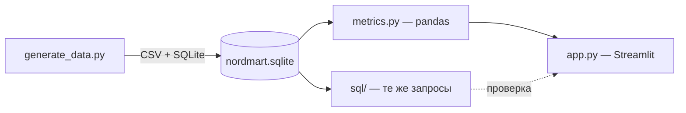

# NordMart — воронка и удержание

<p align="center">
  
  
  
  
  
</p>

<p align="center">
  <b>Product analytics case · e-commerce</b><br/>
  Где ломается оплата, какой трафик пустой, кого магазин удерживает<br/>
  <i>Разбор воронки интернет-магазина по шагам, устройствам, каналам и категориям — не средний CR, а точка провала.</i>
</p>

<p align="center">
  <b>Решение.</b> Главный рычаг — mobile checkout, не верх воронки. iOS платит из чекаута на <b>38% хуже desktop</b>.
  Paid social раздувает сессии и слабо тащит в корзину.
</p>

---

## О проекте

**NordMart** — учебный кейс портфолио для стажировки **product analyst**: 8 недель синтетических сессий условного интернет-магазина.

Продуктовый вопрос: трафик растёт, а выручка отстаёт — на каком шаге воронки и в каком сегменте (девайс, канал, категория) теряем оплату, и что чинить первым. Данные синтетические, но эффекты специально заложены в генератор, чтобы выводы пересчитывались из SQL и дашборда, а не выдумывались из графика.

```text
┌────────────────────────────────────────────────────────────┐
│                === NORDMART DASHBOARD ===                  │
│                                                            │
│  KPI: users · sessions · CR · AOV · repeat                 │
│  Воронка: сессия → просмотр → корзина → чекаут → оплата    │
│  Checkout → pay по device      Канал: CR × revenue/session │
│  Когорты: retention по неделям  Категории: где бросают     │
└────────────────────────────────────────────────────────────┘
```

---

## Стек

| Технология     | Зачем в проекте                                              |
| -------------- | ------------------------------------------------------------- |
| **Python 3.10+** | язык генератора данных и аналитики                           |
| **pandas**       | расчёт воронки, когорт и KPI                                  |
| **SQLite + SQL** | те же метрики через запросы — проверка pandas и вопрос для собеса |
| **Streamlit**    | дашборд: KPI-карточки, графики, текстовые выводы              |
| **Plotly**       | воронка, бары по девайсам, scatter по каналам, heatmap когорт |

---

## Что нашёл

|     | Находка                    | Что значит                                                              |
| --- | --------------------------- | ------------------------------------------------------------------------ |
| ✓   | **Mobile checkout**          | iOS доходит до оплаты из чекаута на **38% хуже desktop** — рычаг в форме оплаты, не в каталоге |
| ✓   | **Paid social — объём без качества** | Много просмотров, но в корзину кладут почти вдвое реже других каналов     |
| ✓   | **Email — лучший канал**     | Меньше сессий, но выше конверсия и выручка на сессию                     |
| ✓   | **Electronics бросают корзину** | Кладут в корзину охотнее остальных категорий, но реже доходят до оплаты  |
| ✓   | **Retention считается по когортам** | Weekly session retention от недели first_seen, не общий процент         |

### Модель данных

```text
users     user_id, first_seen, acq_channel, primary_device
sessions  session_id, user_id, session_ts, device, channel, category
events    event_id, session_id, user_id, event_ts, event_name, category, revenue

FUNNEL_STEPS = session_start → view_item → add_to_cart → begin_checkout → purchase
```

---

## Архитектура



| Файл                  | Ответственность                                                   |
| ---------------------- | -------------------------------------------------------------------- |
| `src/generate_data.py` | синтетика: 12 000 пользователей, вероятности шагов по каналу/девайсу/категории |
| `src/metrics.py`       | воронка, когорты, KPI на pandas — единственный аналитический слой  |
| `sql/`                 | те же вопросы на чистом SQL: воронка, когорты, каналы               |
| `app.py`               | дашборд: графики + текстовые продуктовые выводы                    |

**Почему так?** Дашборд не считает метрики сам — только вызывает функции `metrics.py`, чтобы логика жила в одном месте. SQL дублирует pandas: воронка считается через флаги событий в сессии (`MAX(event_name = 'purchase')`), а не «на глаз по графику» — это то, что обычно спрашивают на собесе.

---

## Структура

```text
nordmart-funnel-analytics
├── app.py
├── README.md
├── requirements.txt
├── src
│   ├── generate_data.py
│   └── metrics.py
├── sql
│   ├── 01_funnel.sql
│   ├── 02_cohorts.sql
│   └── 03_channels.sql
└── data
    ├── users.csv
    ├── sessions.csv
    ├── events.csv
    └── nordmart.sqlite
```

---

## Быстрый старт

### 1. Требования

- Python **3.10+**

### 2. Установка

```bash
python3 -m venv .venv && source .venv/bin/activate
pip install -r requirements.txt
```

### 3. Данные

```bash
python src/generate_data.py
```

> Можно пропустить — дашборд сам сгенерирует данные, если `nordmart.sqlite` ещё нет.

### 4. Запуск

```bash
streamlit run app.py
```

Из корня портфолио (если оба кейса в одном репозитории):

```bash
streamlit run shop-funnel-analytics/app.py
```

---

## Пример вывода

```text
Пользователи               12 000
Сессии                     ~35 000
Session CR                    7.9%
AOV                        ~2 700 ₽
Повторные покупатели           12%

Checkout → pay, desktop         75%
Checkout → pay, iOS             47%   (−38% к desktop)
```

---

## Ключевые решения в коде

<details>
<summary><b>Почему воронка считается по флагам сессии, а не по среднему CR?</b></summary>

<br/>

Один клиент = много событий в сессии. Флаг "был ли шаг" убирает дубликаты и даёт честный шаг-к-шагу:

```python
flags = (
    events.assign(_one=1)
    .pivot_table(index="session_id", columns="event_name", values="_one", aggfunc="max", fill_value=0)
)
```

То же самое в SQL — `MAX(event_name = 'purchase')` на группировке по `session_id`, чтобы на собесе показать: цифры считаются запросом, а не «на глаз по графику».
</details>

<details>
<summary><b>Почему paid_social нельзя судить по числу сессий?</b></summary>

<br/>

Канал сравнивается не по объёму трафика, а по выручке на сессию и доле, доходящей до корзины:

```python
rps = rev.groupby("channel")["revenue"].sum() / sessions.groupby("channel").size()
```

`paid_social` даёт много просмотров и мало в корзине (add_to_cart от view ниже, чем у остальных каналов в разы) — маркетинговый KPI на CPC здесь вводит в заблуждение.
</details>

<details>
<summary><b>Почему когорта — неделя first_seen, а не календарная неделя?</b></summary>

<br/>

Retention считается от даты первого визита пользователя, а не от календаря — иначе пользователи, пришедшие в разные дни недели, будут сравниваться некорректно:

```python
u["cohort"] = u["first_seen"].dt.to_period("W").dt.start_time
s["week_n"] = ((s["session_ts"] - s["first_seen"]).dt.days // 7).clip(lower=0)
```
</details>

<details>
<summary><b>Почему generate_data.py детерминирован (seed=42)?</b></summary>

<br/>

`numpy.random.default_rng(42)` — один и тот же запуск даёт одни и те же 12 000 пользователей и события. Это позволяет пересчитать любую цифру из README и получить точно те же значения, а не «примерно похожие».
</details>
